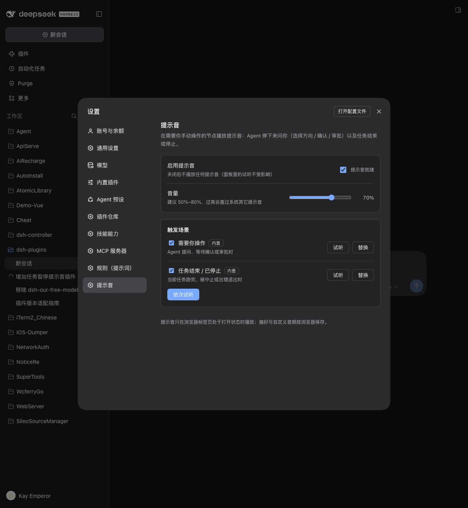

# dsh-plugin-sound-alert

DSH 手动交互提示音插件：**Agent 停下来需要你动手时响一声**。

长任务跑着，人不可能一直盯着窗口。这个插件把「需要人工操作」的时刻变成声音：

| 场景 | 触发条件 | 声音 |
|---|---|---|
| 需要你操作 | 会话出现待处理交互（`ask_user_question` 选方向、审批请求、plan 复核） | `attention.wav`：上行纯五度双音铃（A5 → E6） |
| 任务结束 / 已停止 | 会话由运行中变为空闲（跑完、被中止、出错退出） | `done.wav`：下行纯五度双音铃（E6 → A5） |

子代理会话结束不会打扰（只提醒主会话），同场景 280ms 内合并连发。

## 安装

```bash
dsh plugin --profile <profile> add \
  "https://github.com/skyle1995/dsh-plugins.git#main&path:packages/dsh-plugin-sound-alert"
```

安装后刷新页面（⌘/Ctrl+R），设置 → **提示音**。

## 设置

设置面板「提示音」分区（与其它插件的分区并列）：



- **启用提示音**：总开关；
- **音量**：0–100%，实时生效；
- **触发场景**：两个场景各一行，互不影响：
  - 复选框 = **单独禁用 / 启用**该场景（关掉「需要你操作」不影响「任务结束」）；
  - **试听** = 立刻按当前音量播放该场景当前的提示音；
  - **替换** = 选本地音频文件（wav / mp3 / m4a / ogg / flac，≤4MB）替换该场景提示音，
    生效后徽标从「内置」变「自定义」并显示文件名；
  - **恢复默认** = 丢掉自定义文件，回到内置提示音（仅自定义时出现）；
- **依次试听**：连续播放两段（自定义生效时播自定义），确认音色与音量。

偏好写在浏览器 `localStorage`（键 `dsh-plugin-sound-alert:prefs:v1`）；
自定义音频存在浏览器 IndexedDB（库名 `dsh-plugin-sound-alert:audio`），按浏览器保存，
刷新/重启后自动读回。

## 提示音来源

`assets/attention.wav` / `assets/done.wav`（32 kHz / 16-bit / 单声道，各约 1.15s）。
构建时由 `scripts/build-client.mjs` 转成 base64 data URI 内联进 `lib/client.js`，
运行时**不依赖宿主路由或静态文件服务**——宿主半区只有一行服务，音频随 bundle 下发。

想换音色有两条路：

1. **界面里换**：设置 → 提示音 → 对应场景的「替换」，选一个本地音频文件即可（无需构建、无需重启）；
2. **换内置默认值**：替换 `assets/*.wav` 后重新构建，或改 `tools/generate-sounds.mjs` 的合成参数
   （音名、谐波、衰减时间常数、低通截止）。

```bash
node tools/generate-sounds.mjs   # 重新合成两段 WAV
node scripts/build-client.mjs    # 重新打包 lib/client.js
```

## 诊断

浏览器控制台里有诊断入口：

```js
__DSH_SOUND_ALERT__.mounted        // 会话状态监听是否挂载（true 才算生效）
__DSH_SOUND_ALERT__.plays          // 已发起的播放次数
__DSH_SOUND_ALERT__.prefs()        // 当前偏好
__DSH_SOUND_ALERT__.custom()       // 已替换的自定义音频文件名（null 表示内置）
__DSH_SOUND_ALERT__.preview('done') // 手动试听
```

宿主侧只读自检：`GET /api/dsh-plugin-sound-alert/status`（需 Web 会话凭据）。

浏览器自动播放策略：页面首次加载后需要一次点击或按键，之后播放才被放行。
被拦截时设置页会给出提示，并自动挂一次性手势解锁（下一次点击/按键后恢复）。

## 实现要点

- **状态源**：监听 `ctx.uiSession.sessionStatus`（`Map<sessionId, { running,
  pendingInteraction, completionUnread }>`，由 `@deepseek-ai/dsh-client-ui-session` 提供）。
  首次快照只做基线，不补发一串历史提示音。
- **主会话过滤**：`running` 由 true 变 false 时读 `ctx.sessions.list` 的
  `retainedBy.mainView`，为 0 的会话（子代理）静默；读不到信息时按主会话处理，
  宁可多响一次也不漏。
- **宿主行的作用**：DSH 的浏览器 bundle 由 `@deepseek-ai/dsh-client-modules`
  按**宿主 loader 条目**扫描 `dsh.client` 声明后下发，所以本包必须同时提供宿主半区
  （`lib/index.js`，服务键 `soundAlert`）与浏览器半区（`lib/client.js`）。
- **无构建依赖**：宿主半区是手写 ESM；浏览器半区预构建并提交（仓库约定）。
- **`0.2.1` 生命周期优化**：自定义音频每次更新产生新快照，确保 React 立即更新
  文件名与「恢复默认」按钮；同场景替换/重置串行落盘，忽略过期恢复结果。
  IndexedDB 成功、失败或交易中止后关闭连接；卸载时停止播放并释放音频对象、
  Blob URL、自动播放手势监听及面板计时器。取消文件选择时移除隐藏 input。

## 开发

```bash
node tools/generate-sounds.mjs   # 生成 assets/*.wav
node scripts/build-client.mjs    # 构建 lib/client.js（需要 esbuild）
node test/smoke.mjs              # 离线冒烟测试（node:vm 模拟浏览器环境）
```

冒烟测试覆盖：导出面、设置分区注册契约与面板渲染、状态跃迁（基线/待操作/新交互/结束/幂等）、
子代理过滤、偏好（总开关/音量/localStorage/试听）、场景开关、自定义音频（类型/大小校验 → 替换 →
播放自定义源 → 恢复默认）、自动播放拦截与手势解锁。

新增资源回归：仓库根运行 `node --test demo-test/sound-alert.test.mjs`。
真实 React/IndexedDB 测试页：`node demo-test/sound-alert-browser.mjs`，按打印的
本地地址打开，验证替换、恢复默认，再卸载并删除测试数据库；结束按 `Ctrl+C`。
本轮已在 Windows 浏览器验证，macOS Safari 真机仍需确认自动播放策略与文件选择行为。
